<!-- Banner -->
<p align="center">
  <a href="https://maullanailhammm.github.io/Portofolio-Maullana/">
    
  </a>
</p>

<p align="center">
  <a href="https://git.io/typing-svg">
    
  </a>
</p>

<p align="center">
  <a href="https://maullanailhammm.github.io/Portofolio-Maullana/"></a>
  <a href="https://linkedin.com/in/maullanailham"></a>
  <a href="mailto:maullanailham65@gmail.com"></a>
  
</p>

---

## 👨‍💻 About Me

```python
class Allan:
    name       = "Maullana Ilham Ar Rosyiid Mariandi"
    location   = "Sidoarjo, East Java 🇮🇩"
    education  = "B.Sc. Informatics @ Universitas Muhammadiyah Malang (GPA 3.61/4.00)"
    focus      = ["Web Development", "Data Science"]
    stack      = ["Laravel", "REST API", "JWT", "Python", "Scikit-learn"]
    looking_for = "Internship in Web Development or Data Science 🚀"
```

7th-semester Informatics student with hands-on experience building **web applications** with Laravel, REST API, and JWT, and developing **machine learning models** for text and tabular data classification using Python and Scikit-learn. Comfortable with data processing, analysis, and problem solving, plus team coordination from organizational and community service work.

---

## 🛠️ Tech Stack

**Programming Languages**

<p align="center">
  &nbsp;&nbsp;&nbsp;&nbsp;&nbsp;&nbsp;&nbsp;&nbsp;&nbsp;&nbsp;&nbsp;&nbsp;&nbsp;&nbsp;&nbsp;&nbsp;&nbsp;&nbsp;
</p>

**Web & App Development**

<p align="center">
  &nbsp;&nbsp;&nbsp;&nbsp;&nbsp;&nbsp;&nbsp;&nbsp;&nbsp;&nbsp;&nbsp;&nbsp;&nbsp;&nbsp;&nbsp;&nbsp;&nbsp;&nbsp;&nbsp;&nbsp;&nbsp;
</p>

**Data Science & Machine Learning**

<p align="center">
  &nbsp;&nbsp;&nbsp;&nbsp;&nbsp;&nbsp;&nbsp;&nbsp;&nbsp;&nbsp;&nbsp;&nbsp;
</p>

**Tools**

<p align="center">
  &nbsp;&nbsp;&nbsp;&nbsp;&nbsp;&nbsp;&nbsp;&nbsp;&nbsp;&nbsp;&nbsp;&nbsp;&nbsp;&nbsp;&nbsp;&nbsp;&nbsp;&nbsp;<picture><source media="(prefers-color-scheme: dark)" srcset="https://cdn.simpleicons.org/github/white"></picture>
</p>

<p align="center"><sub>Also familiar with: SQL · REST API · NLTK · Gensim · Seaborn · imbalanced-learn · joblib</sub></p>

---

## 🚀 Featured Projects

### 🐾 Web Petcare
`Laravel` `Tailwind CSS` `JavaScript` `REST API` `JWT`

Pet care platform with a landing page, user dashboard, and admin dashboard, using **JWT authentication** with role-based access (user & admin).
- REST API for pet data, booking of **4 services** (grooming, vaccination, check-up, treatment), and admin management of services and team
- Booking schedule validation, booking history, and status tracking (pending, in progress, done, canceled)
- Social login scaffolding (Google, Facebook, GitHub)

### 📚 Food Regulation Document Classification with NLP
`Python` `NLTK` `Gensim` `Scikit-learn` `Hugging Face Transformers`

Text classification model for **40,000+** food and agriculture regulation documents (FAOLEX) based on their abstracts, with a full preprocessing pipeline: cleaning, tokenization, stopword removal, and stemming.
- Ran **9 experiment scenarios**: Decision Tree and Naive Bayes with BoW, TF-IDF, N-Gram, Word2Vec, and BERT
- Best result: **Naive Bayes + N-Gram with 78.3% accuracy**

### 🌾 Crop Yield Prediction from Climate Change
`Python` `Scikit-learn` `Google Colab`

Classification model to predict crop yield category (Low / Medium / High) from climate, environment, farming practice, and soil data (Kaggle dataset, 10,000 rows × 15 columns).
- Preprocessing: missing/duplicate checks, encoding, standardization, feature selection
- Compared **Decision Tree (59.2%)** vs **Gaussian Naive Bayes (65.35%)** with an 80:20 split

> 🔗 Add repository links to each project, e.g. `[View repo](https://github.com/maullanailhammm/repo-name)`.

---

## 🎓 Education

**Universitas Muhammadiyah Malang** — B.Sc. Informatics, GPA **3.61 / 4.00** *(Sep 2023 – Jul 2027, expected)*

Relevant courses: Data Mining · Natural Language Processing · Data Modeling & Simulation · Artificial Intelligence · Database · Data Structures · Statistics & Probability

🗣️ **Languages:** Indonesian (native), English (elementary)

---

## 📈 GitHub Stats

<div data-importer="stats" align="center">
  
  
  
  
</div>

<picture data-importer="pacman">
  <source media="(prefers-color-scheme: dark)" srcset="https://raw.githubusercontent.com/maullanailhammm/maullanailhammm/output/pacman-contribution-graph-dark.svg">
  <source media="(prefers-color-scheme: light)" srcset="https://raw.githubusercontent.com/maullanailhammm/maullanailhammm/output/pacman-contribution-graph.svg">
  
</picture>

---

## 🤝 Let's Connect

I'm looking for an **internship in Web Development or Data Science**. Feel free to reach out!

<p align="center">
  <a href="https://maullanailhammm.github.io/Portofolio-Maullana/"></a>
</p>

<br clear="both">

<div data-importer="socials" align="center">
  <a href="mailto:maullanailham65@gmail.com"></a>
  <a href="https://linkedin.com/in/maullanailham"></a>
  
  
  
  
</div>
